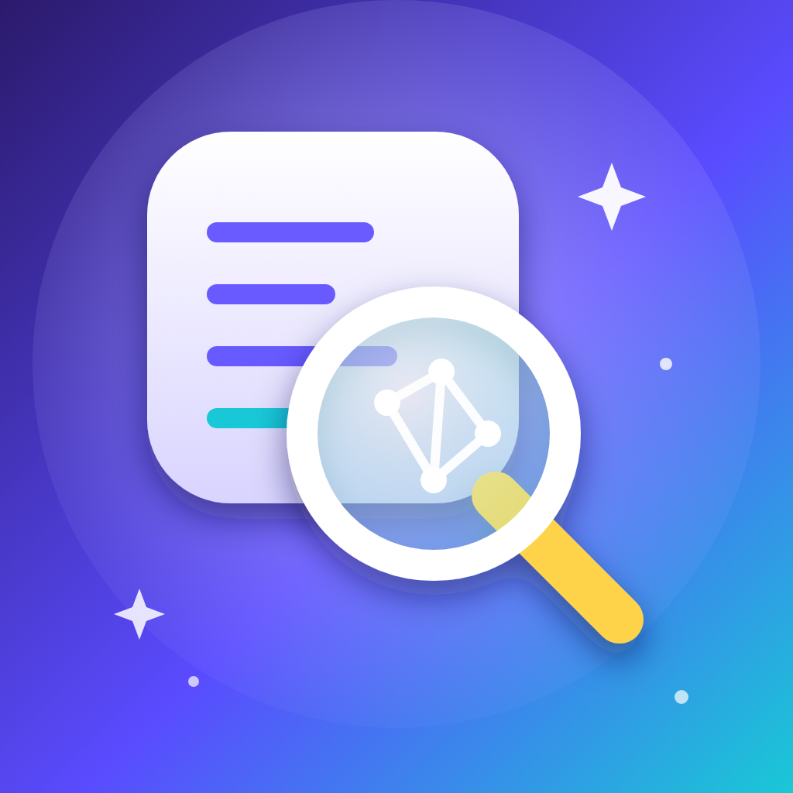

<p align="center">
  
</p>

<h1 align="center">RAE</h1>

<p align="center"><b>Reverse engineer an app with AI, then build a small performance tweak for it.</b><br>
A rootless jailbreak app for iPhone (arm64, iOS 15+), made for the iPhone 7 Plus. Inspired by <a href="https://github.com/morluto/rea">REA</a>.</p>

## What it does

1. **Choose a decrypted IPA** from Files. RAE reads it on the phone. It never modifies, cracks or hacks it.
2. **Analysis.** It reads the app's `Info.plist`, size by file type, embedded frameworks and SDKs, and inspects the arm64 binary: linked libraries, the system calls it imports, its own classes, functions, string signals, graphics APIs, the game engine (Unity, Unreal, Cocos, Flutter, React Native, native) and how it paces frames.
3. **AI report.** With your own Anthropic API key, Claude reads that analysis and writes a detailed report: how the app is built, where lag, RAM, CPU, heat and battery drain probably come from, what a tweak can and cannot do, and tips.
4. **Performance dylib.** RAE generates a small tweak for that one app (`com.rae.boost.<bundle id>`), named after the project. You can rename it.
5. **Online build.** With your own GitHub token, RAE pushes the source to your builds repository, GitHub Actions compiles the rootless `.deb`, and RAE downloads it. Share it to Sileo, Zebra or Filza to install, then respring.

## What the generated tweak can do

Only these, switchable per app:

| Feature | What it does |
| --- | --- |
| Frame rate | *Leave*: the app's own rate. *Smooth*: if the app asks for less than your screen can show (30 fps on a 60 Hz screen), it gets the screen's full rate: 60 on an iPhone 7 Plus, 120 on ProMotion phones. *Cool*: never above 60 fps. |
| Memory trim | Frees memory when the system warns, when the app goes to the background, and when the app is running low. |
| Timer saving | Gives long repeating timers a little slack so the system can batch wake-ups. |
| Background quiet | Lowers the app's priority while it is in the background. Switched off automatically for apps that need background audio, calls, location or Bluetooth. |
| Thermal guard | Steps in only when iOS reports the phone is hot (serious or critical), instead of letting the system cut harder. |

It never touches the app's files, game logic, purchases, network traffic, anti-cheat or any protection.

## Honest limits

- **No tweak can promise "no lag, no heat, no battery use" for every app, all day.** A heavy 3D game on an A10 chip will always use CPU, GPU and battery. These levers reduce waste; they do not remove the work. Results depend on the app and the phone.
- **RAE does not decrypt.** An IPA straight from the App Store is encrypted (FairPlay). RAE detects this and tells you; only the headers can be read until it is decrypted.
- **The analysis is static.** It reads the files and the binary, it does not run the app. The report separates facts from guesses.
- **The dylib is built online, not on the phone.** iOS has no compiler. The build uses your own GitHub repository (public by default, so builds are free) and takes about 3 to 5 minutes.
- **Installing the `.deb` needs a package manager.** RAE hands the file to Sileo, Zebra or Filza; it cannot install packages by itself.
- Your Anthropic key and GitHub token are stored in this app's storage on your phone and used only to talk to `api.anthropic.com` and `api.github.com`. RAE sends Claude the analysis text, never the IPA.

## Install

Download the `.deb` from **Releases**, install it with Sileo, Zebra or Filza, respring, and open **RAE**. Rootless only (Dopamine, palera1n rootless), iOS 15.0 or later, arm64.

## Settings (gear icon)

| Field | What to enter |
| --- | --- |
| API key / Model | Your Anthropic key, and the model (default `claude-sonnet-5-5`). |
| Token | A GitHub token with `repo` and `workflow` permissions. |
| Repository | `owner/name` for builds. Empty = `<you>/RAE-Builds`, created automatically. |

## How it is built

```
Sources/RAEZip.c        IPA (zip, deflate, ZIP64) reader
Sources/RAEMachO.c      arm64 Mach-O inspector (load commands, imports, classes, strings, encryption flag)
Sources/RAEAnalyzer.m   turns the raw facts into findings and a suggested profile
Sources/RAEClaude.m     the AI report (Anthropic Messages API)
Sources/RAEGenerator.m  fills the tweak templates for one app
Sources/RAEGitHub.m     uploads the project, starts the build, downloads the .deb
Resources/templates/    the generated tweak (Tweak.x, Makefile, control, workflow)
tests/                  C tests for the zip and binary readers (run in CI with a fake IPA)
```

CI builds the app, runs the reader tests, and also compiles the generated-tweak template in three variants (all on, all off, cool) so a template error cannot reach your builds.

## Build

Needs [Theos](https://theos.dev).

```sh
make package FINALPACKAGE=1 THEOS_PACKAGE_SCHEME=rootless
```

## License

MIT
